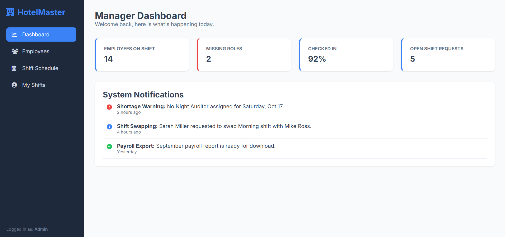
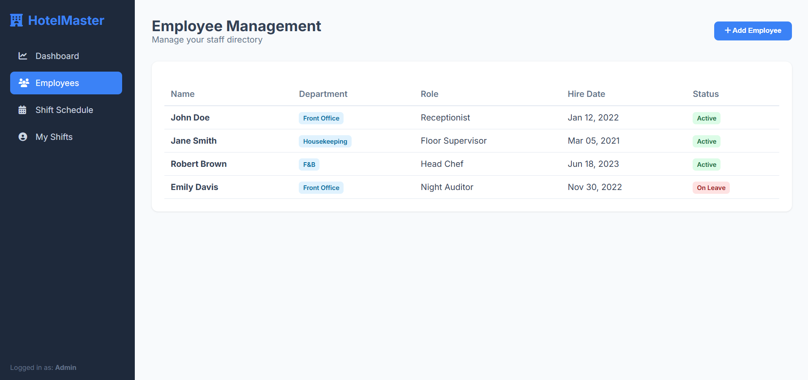
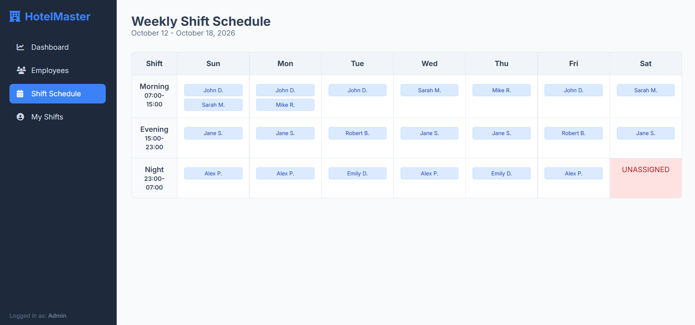
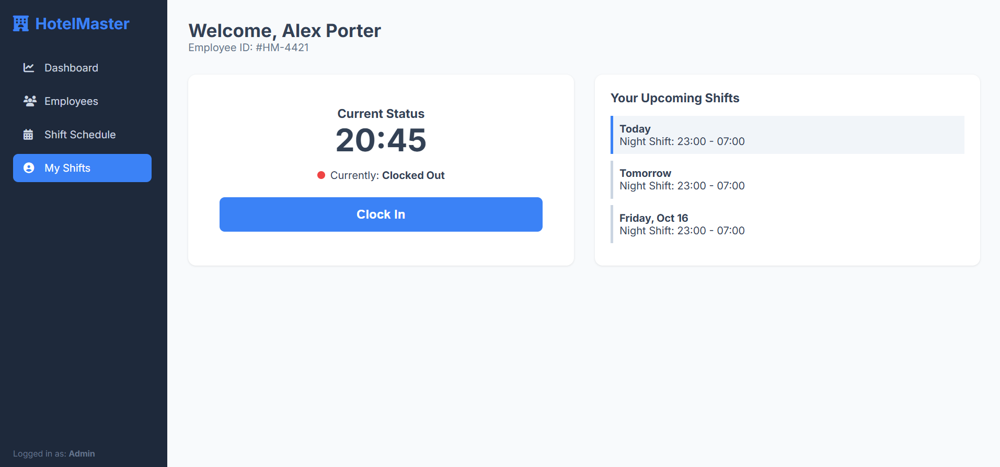
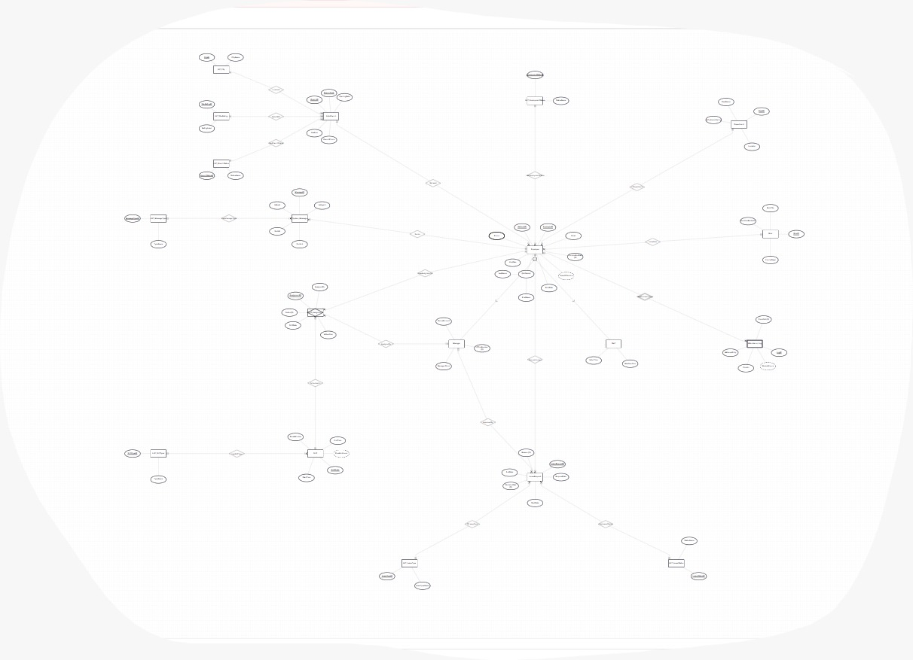

# HotelMaster – Employee & Shift Management System

**Stage A Report – Database Design (ERD + Data Dictionary)**

| | |
|---|---|
| **Submitted by** | Agam Tzaban,Osnat Zimmerman |
| **Selected system** | Hotel Management System (HotelMaster) |
| **Selected unit** | Employees & Shifts |
| **ERD file** | `HotelMaster_ERD.erdplus` (ERDPlus) |

---

## Table of Contents

1. [Introduction](#1-introduction)
2. [System Screens (Top-Down)](#2-system-screens-top-down)
3. [ERD Diagram](#3-erd-diagram)
4. [Design Decisions](#4-design-decisions)
5. [Data Dictionary](#5-data-dictionary)
   - [5.1 Core entities](#51-core-entities)
   - [5.2 Lookup (ENUM) tables](#52-lookup-enum-tables)
   - [5.3 Relationships summary](#53-relationships-summary)
6. [Integration with the RoomBooking & Accommodation Schema](#6-integration-with-the-roombooking--accommodation-schema)
7. [Requirements Checklist](#7-requirements-checklist)

---

## 1. Introduction

HotelMaster is a hotel management system. Our unit is **Employees & Shifts**: the part of the system that manages the people who work in the hotel branches and the schedule they work by.

**Data stored in the system**

- Employees, their personal details, hire date and employment status, the hotel branch they work at, their department and their role (with an hourly wage).
- Two kinds of employees: **Managers** (bonus percentage, office) and **Staff** – front-line workers such as receptionists and housekeepers (overtime limit).
- A catalog of **shifts** (morning / evening / night) and the **actual assignment** of an employee to a shift on a specific date.
- **Attendance logs** – clock-in / clock-out of every employee.
- **Leave requests** and their approval by a manager.
- **System messages** shown in the manager dashboard (e.g. a shift-swap request, an urgent alert).

**Main functionality**

1. An employee clocks in and out from a personal area.
2. A manager builds and edits the weekly shift board by assigning employees to shifts.
3. A manager reviews messages, urgent alerts and leave requests in a dashboard.
4. HR maintains employees, departments and roles.

---

## 2. System Screens (Top-Down)

The design was done top-down: first the four screens of the final system were defined and prototyped with **Google AI Studio** (a front-end prototype, not connected to a database), and the tables were derived from them.

| # | Screen | Purpose | Main data it needs |
|---|---|---|---|
| 1 | **Personal Area** | Employee sees own details and presses the green / red button to clock in / out | Employee, Attendance_Log |
| 2 | **Shift Board** | Weekly schedule of who works which shift | Shift, Shift_Assignment, Employee |
| 3 | **Manager Dashboard** | Messages, swap requests, urgent alerts, pending leave requests | System_Message, LeaveRequest, Manager |
| 4 | **Employee Management Form** | Add / edit employees, choose department, role and branch | Employee, Department, Role, HotelBranch |

### Manager Dashboard

### Employee Management

### Shift Schedule

### Personal Area

> The system specification may still change; the screens are the basis from which the tables were designed.

---

## 3. ERD Diagram

Diagram name: **HotelMaster_ERD** (ERDPlus, file `HotelMaster_ERD.erdplus` – can be imported directly into ERDPlus).

**Diagram features used**

| Feature | Where |
|---|---|
| Inheritance (Supertype / Subtype) | `Employee` → `Manager`, `Staff` |
| Weak entity + identifying relationship | `Attendance_Log` (depends on `Employee`) |
| Associative entity (M:N resolved) | `Shift_Assignment` between `Employee` and `Shift` |
| Multivalued attribute | `Employee.Phone` |
| Composite attribute | `Employee.FullName` (`FirstName`, `LastName`) |
| Derived attributes | `YearsOfService`, `DurationHours`, `WorkedHours` |
| Optional attributes | `TerminationDate`, `OfficeNumber`, `ClockOut`, `Notes`, `Reason`, `DecisionDate` |
| Lookup (ENUM) tables | 8 `LUT_*` tables (see 5.2) |
| DATE attributes | `HireDate`, `BirthDate`, `TerminationDate`, `ShiftDate`, `AssignedOn`, `StartDate`, `EndDate`, `RequestDate`, `DecisionDate`, `ManagerSince`, `OpeningDate` |

---

## 4. Design Decisions

- **Shift_Assignment is an associative entity** (M:N between Employee and Shift). It has its own key `AssignmentID`, because the same employee can work the same shift type on many different dates; `ShiftDate` is therefore a normal attribute and not part of a composite key.
- **Attendance_Log is a weak entity.** A log record has no meaning without its employee; `LogID` is a partial key.
- **Manager / Staff use inheritance.** All common data stays in `Employee`; only role-specific data is in the subtypes.
- **ENUM values are lookup tables** (`LUT_*`, key + value) and are **not** counted in the number of system entities. Therefore `ShiftType`, `EmploymentStatus`, `LeaveType`, `LeaveStatus` and `MessageType` are relationships to lookup tables rather than free-text attributes.
- **Added entity: `LeaveRequest`** (with `LeaveType`, `LeaveStatus` lookups) – gives the manager dashboard real content and a second use of the `Manager` subtype (`ApprovedBy`).
- **`HotelBranch` is a shared entity** with the RoomBooking schema (see section 6).

---

## 5. Data Dictionary

Legend: **PK** – primary key, **PPK** – partial key (weak entity), **FK** – foreign key (comes from a relationship), **Opt** – optional (nullable), **Derived** – calculated, not stored.

### 5.1 Core entities

There are **11** core entities (not counting lookup tables).

#### 1. HotelBranch – shared with RoomBooking schema

**Purpose:** a physical hotel branch; every employee works at one branch.
**Type / relationships:** strong entity. Relationships: `LocatedIn` (City 1:N), `RatedWith` (StarRating 1:N), `HasBranchStatus` (BranchStatus 1:N), `WorksAt` (1:N to Employee).

| Field | Description | Notes |
|---|---|---|
| BranchID | Branch identifier | PK |
| BranchCode | Short branch code | Unique |
| OpeningDate | Date the branch opened | DATE |
| HasPool | Branch has a pool | Boolean |
| BranchPhone | Branch phone number | |
| CityID | City of the branch | FK → LUT_City |
| StarRatingID | Star rating | FK → LUT_StarRating |
| BranchStatusID | Operating status | FK → LUT_BranchStatus |

#### 2. Employee

**Purpose:** base data of every hotel employee.
**Type / relationships:** strong entity, **supertype** of `Manager` and `Staff`. N:1 to HotelBranch, Department, Role, LUT_EmploymentStatus. 1:N to Shift_Assignment, Attendance_Log (identifying), System_Message, LeaveRequest.

| Field | Description | Notes |
|---|---|---|
| EmployeeID | Employee number | PK |
| NationalID | National ID / passport | Unique |
| FullName | Full name | Composite: FirstName, LastName |
| HireDate | Date the employee started | DATE |
| BirthDate | Date of birth | DATE |
| TerminationDate | Date employment ended | DATE, Opt |
| Phone | Phone number(s) | Multivalued |
| Email | Work e-mail | |
| YearsOfService | Years since HireDate | Derived |
| BranchID | Branch the employee works at | FK → HotelBranch |
| DeptID | Department | FK → Department |
| RoleID | Role | FK → Role |
| EmploymentStatusID | Current status | FK → LUT_EmploymentStatus |

#### 3. Manager (subtype of Employee)

**Purpose:** data specific to employees who are managers (manager dashboard).
**Type / relationships:** subtype – inherits every field of Employee. Approves leave requests (`ApprovedBy`) and creates shift assignments (`AssignedBy`).

| Field | Description | Notes |
|---|---|---|
| EmployeeID | Same as Employee | PK + FK → Employee |
| BonusPercent | Management bonus percentage | |
| OfficeNumber | Personal office | Opt |
| ManagerSince | Date promoted to manager | DATE |

#### 4. Staff (subtype of Employee)

**Purpose:** data specific to line workers (receptionist, housekeeper…).
**Type / relationships:** subtype – inherits every field of Employee.

| Field | Description | Notes |
|---|---|---|
| EmployeeID | Same as Employee | PK + FK → Employee |
| MaxOvertime | Monthly overtime limit (hours) | |
| IsFullTime | Full-time / part-time | Boolean |

#### 5. Department

**Purpose:** hotel departments (Reception, Housekeeping, Kitchen…).
**Type / relationships:** strong entity. 1:N to Employee (`InDepartment`).

| Field | Description | Notes |
|---|---|---|
| DeptID | Department identifier | PK |
| DeptName | Department name | |
| Location | Location in the hotel | |
| IsCustomerFacing | Works directly with guests | Boolean |

#### 6. Role

**Purpose:** job titles and their hourly wage.
**Type / relationships:** strong entity. 1:N to Employee (`HoldsRole`).

| Field | Description | Notes |
|---|---|---|
| RoleID | Role identifier | PK |
| RoleTitle | Job title | |
| HourlyWage | Wage per hour | |
| OvertimeMultiplier | Pay multiplier for overtime hours | |

#### 7. Shift (shift catalog)

**Purpose:** defines the shift types of the hotel (morning / evening / night).
**Type / relationships:** strong entity. M:N with Employee through `Shift_Assignment`. N:1 to LUT_ShiftType.

| Field | Description | Notes |
|---|---|---|
| ShiftCode | Shift identifier | PK |
| StartTime | Start time | |
| EndTime | End time | |
| BreakMinutes | Unpaid break length | |
| DurationHours | Shift length | Derived |
| ShiftTypeID | Morning / evening / night | FK → LUT_ShiftType |

#### 8. Shift_Assignment (associative entity)

**Purpose:** the actual assignment of an employee to a shift on a specific date (the shift board).
**Type / relationships:** associative entity created from the M:N between Employee and Shift. Also N:1 to Manager (who made the assignment).

| Field | Description | Notes |
|---|---|---|
| AssignmentID | Assignment identifier | PK |
| EmployeeID | The assigned employee | FK → Employee |
| ShiftCode | The assigned shift | FK → Shift |
| ShiftDate | Date of the shift | **DATE** |
| AssignedOn | Date the assignment was created | DATE |
| IsOvertime | Counts as overtime | Boolean |
| Notes | Free remarks | Opt |
| AssignedByManagerID | Manager who created it | FK → Manager, Opt |

#### 9. Attendance_Log (weak entity)

**Purpose:** records clock-in and clock-out (the green / red button in the personal area).
**Type / relationships:** **weak entity**, fully dependent on Employee (identifying relationship `HasAttendanceLogs`).

| Field | Description | Notes |
|---|---|---|
| LogID | Log number within the employee | PPK (dashed underline) |
| EmployeeID | The owning employee | PK part, FK → Employee |
| ClockIn | Clock-in time | DATETIME |
| ClockOut | Clock-out time | DATETIME, Opt (employee still in shift) |
| IsManualEntry | Entered manually by a manager | Boolean |
| WorkedHours | ClockOut − ClockIn | Derived |

#### 10. System_Message

**Purpose:** messages displayed in the manager dashboard (e.g. swap request, urgent alert).
**Type / relationships:** strong entity. N:1 to Employee (sender) and to LUT_MessageType.

| Field | Description | Notes |
|---|---|---|
| MessageID | Message identifier | PK |
| Content | Message text | |
| IsUrgent | Urgent or not | Boolean |
| SentAt | Time sent | DATETIME |
| IsRead | Already read | Boolean |
| EmployeeID | Sender | FK → Employee |
| MessageTypeID | Kind of message | FK → LUT_MessageType |

#### 11. LeaveRequest (added entity)

**Purpose:** employee requests for vacation / sick leave and their approval.
**Type / relationships:** strong entity. N:1 to Employee (requester), Manager (approver, optional), LUT_LeaveType, LUT_LeaveStatus.

| Field | Description | Notes |
|---|---|---|
| LeaveRequestID | Request identifier | PK |
| StartDate | First day of leave | DATE |
| EndDate | Last day of leave | DATE |
| RequestDate | Date of the request | DATE |
| Reason | Employee's reason | Opt |
| DecisionDate | Date of the manager's decision | DATE, Opt |
| EmployeeID | Requesting employee | FK → Employee |
| ApprovedByManagerID | Deciding manager | FK → Manager, Opt |
| LeaveTypeID | Vacation / sick / … | FK → LUT_LeaveType |
| LeaveStatusID | Pending / approved / rejected | FK → LUT_LeaveStatus |

### 5.2 Lookup (ENUM) tables

Key / value tables; not counted among the system entities.

| Table | Fields | Purpose | Used by |
|---|---|---|---|
| LUT_City | CityID (PK), CityName | City of a branch _(shared)_ | HotelBranch |
| LUT_StarRating | StarRatingID (PK), RatingLabel | Star rating _(shared)_ | HotelBranch |
| LUT_BranchStatus | BranchStatusID (PK), StatusName | Branch operating status _(shared)_ | HotelBranch |
| LUT_EmploymentStatus | EmploymentStatusID (PK), StatusName | Active / On leave / Terminated | Employee |
| LUT_ShiftType | ShiftTypeID (PK), TypeName | Morning / Evening / Night | Shift |
| LUT_LeaveType | LeaveTypeID (PK), LeaveTypeName | Vacation / Sick / Unpaid … | LeaveRequest |
| LUT_LeaveStatus | LeaveStatusID (PK), StatusName | Pending / Approved / Rejected | LeaveRequest |
| LUT_MessageType | MessageTypeID (PK), TypeName | Swap request / Announcement / Alert | System_Message |

### 5.3 Relationships summary

| Relationship | Entities | Cardinality | Description |
|---|---|---|---|
| WorksAt | HotelBranch – Employee | 1:N | An employee works at exactly one branch |
| InDepartment | Department – Employee | 1:N | Every employee belongs to one department |
| HoldsRole | Role – Employee | 1:N | Every employee has one role |
| HasEmploymentStatus | LUT_EmploymentStatus – Employee | 1:N | Current status of the employee |
| (Inheritance) | Employee → Manager, Staff | Supertype / subtype | An employee is a manager or a staff member |
| HasAssignments | Employee – Shift_Assignment | 1:N | An employee has many assignments |
| ScheduledIn | Shift – Shift_Assignment | 1:N | A shift type appears in many assignments |
| (M:N) | Employee – Shift | M:N via Shift_Assignment | Employees work many shifts, shifts have many employees |
| AssignedBy | Manager – Shift_Assignment | 1:N (optional) | Manager who created the assignment |
| HasAttendanceLogs | Employee – Attendance_Log | 1:N, **identifying** | Log cannot exist without the employee |
| Sends | Employee – System_Message | 1:N | An employee writes many messages |
| HasMessageType | LUT_MessageType – System_Message | 1:N | Kind of message |
| HasShiftType | LUT_ShiftType – Shift | 1:N | Morning / evening / night |
| RequestsLeave | Employee – LeaveRequest | 1:N | An employee submits many requests |
| ApprovedBy | Manager – LeaveRequest | 1:N (optional) | Manager who decided on the request |
| OfLeaveType | LUT_LeaveType – LeaveRequest | 1:N | Kind of leave |
| HasLeaveStatus | LUT_LeaveStatus – LeaveRequest | 1:N | Decision status |
| LocatedIn / RatedWith / HasBranchStatus | LUT_City / LUT_StarRating / LUT_BranchStatus – HotelBranch | 1:N | _Shared with RoomBooking schema_ |

---

## 6. Integration with the RoomBooking & Accommodation Schema

The diagram was built from the RoomBooking & Accommodation ERDPlus file so that the two schemas can later be merged.

- **`HotelBranch` is the shared entity.** It was copied **exactly** as it is in the RoomBooking schema – the same attributes (`BranchID`, `BranchCode`, `OpeningDate`, `HasPool`, `BranchPhone`) and the same keys.
- Its lookup tables **`LUT_City`, `LUT_StarRating`, `LUT_BranchStatus`** and the relationships `LocatedIn`, `RatedWith`, `HasBranchStatus` are also identical.
- The only new link is `WorksAt` (HotelBranch 1 : N Employee). When the schemas are merged, `HotelBranch` appears once, and both the room/reservation side and the employee side hang from it.
- The employee-side naming follows the same conventions as the RoomBooking schema: `LUT_` prefix for lookup tables, `<Entity>ID` for keys, `Is…/Has…` for booleans, a supertype for `Guest` ⇄ a supertype for `Employee`, an associative entity for `ReservationRoom` ⇄ `Shift_Assignment`.
- Possible future integration points: housekeeping tasks linking `Staff` to `Room`, and linking `Employee` to `Reservation` (the receptionist who handled a booking).

---

## 7. Requirements Checklist

| Requirement | Status |
|---|---|
| At least 6 entities (excluding ENUM tables) | ✅ 11 entities (excluding 8 lookup tables) |
| At least two meaningful DATE attributes | ✅ `HireDate`, `ShiftDate` and many more |
| Rich set of attributes | ✅ composite, multivalued, derived, optional |
| Weak entity | ✅ `Attendance_Log` |
| Inheritance | ✅ `Employee` → `Manager`, `Staff` |
| M:N relationship and associative entity | ✅ `Shift_Assignment` |
| ENUM values as key/value tables | ✅ `LUT_*` |
| Data dictionary (table + verbal) | ✅ section 5 |
| Shared entities identical to the reference file | ✅ `HotelBranch` + 3 lookups |
| Diagram delivered as an ERDPlus file | ✅ `HotelMaster_ERD.erdplus` |
